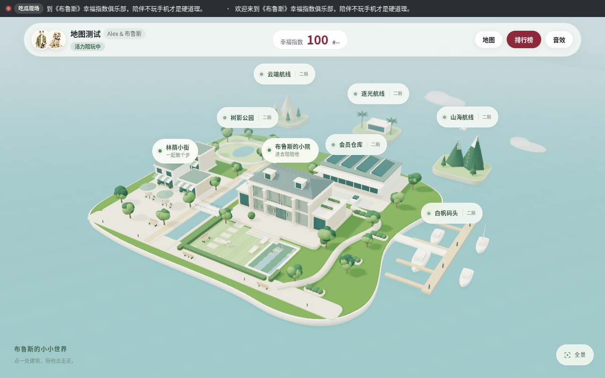
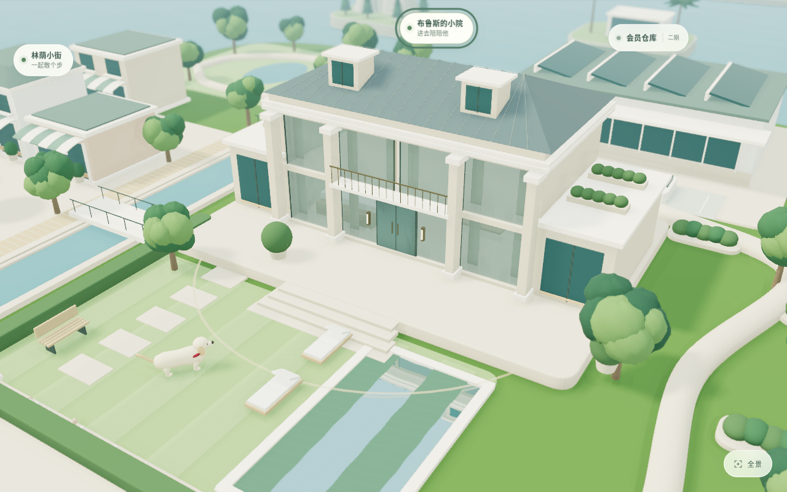
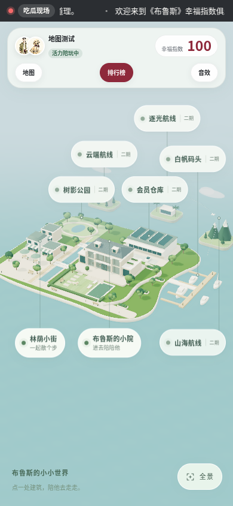
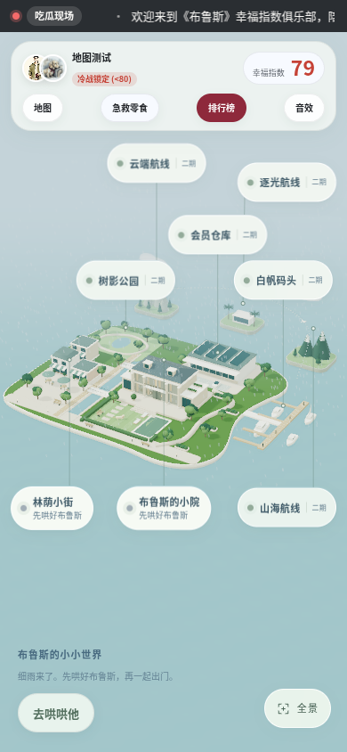

# 阳光建筑微缩世界地图

地图已接入首页。小院与林荫小街分别进入原有的五个活动，六个远景入口打开原有二期内容。没有修改活动逻辑、幸福指数规则、状态模块、API、后端或 `js/cinematic/`。

## 实际渲染





 

以上为本地代码在浏览器中的实际截图。分组验证通过 25 项独立检查，见 [逐项结果](map3d/verification.json)。

## 预览

```sh
python3 scripts/dev_server.py --port 8778
```

打开 `/map3d-preview.html`；`?score=79` 可直接查看冷战雨天。预览页不写入玩家账户或分数。首页则读取原来的 `store`，在幸福指数更新时对现有画布调用 `setSulking`，保持镜头与场景连续。

## 本地依赖与接口

页面在模块脚本之前声明：

```html
<script type="importmap">
{"imports":{"three":"./vendor/three.module.js","three/addons/":"./vendor/addons/"}}
</script>
```

新增的 `vendor/addons/objects/Reflector.js` 来自 Three.js 0.187.0 官方包，与仓库现有版本一致。没有增加另一份 Three.js，也没有 CDN、在线字体或远程贴图依赖。

```js
import { mountWorldMap3D } from './js/map3d.js';

const map = mountWorldMap3D(containerEl, {
  sulking: happiness < 80,
  onSelectPlayable(id) { /* home / street，连接现有场景 */ },
  onSelectPreview(id) { /* park / warehouse / yacht / nordic / california / nz_swiss */ },
});

map.setSulking(happiness < 80);
map.destroy();
```

容器必须有明确的宽高。重复挂载同一容器会销毁上一个实例。`destroy()` 可重复调用，会取消动画、观察器、监听器、请求和未触发的选择回调，并释放材质、纹理、几何体、阴影、倒影和镜头渲染目标。

悬停只做轻微聚焦；点击或键盘确认后，镜头抵达才调用入口回调。冷战会拦住小院和街区，飞行途中进入冷战也会取消进入；二期预告仍可查看。手机拖动不会误触入口。

## 视觉与兼容

石灰岩门廊、浅坡金属屋顶、老虎窗、细金属栏杆与室内陈设区分别构成别墅体量。庭院包含修剪草坪、真实建筑倒影水池、躺椅与种植带。精品街用玻璃橱窗、弧形遮阳篷、户外座椅和行道树区分。曲线岸线与远处雾岸建立纵深，景深与接触阴影保持克制。

当前仓库没有 `js/cinematic/bruceModel.js`，庭院实际复用现有 `js/bruce3d.js` 的奶油长毛腊肠犬与关节动画，并保留其酒红领巾。模块会只读探测可选的 cinematic 模型；探测缺失文件产生的 404 不影响运行。支持工厂 `createBruceModel`、`createBruce`、`buildBruceModel` 或默认工厂，返回 Object3D 或 `group/root/model/mesh/scene` 容器。兼容模型使用自己的克隆资源，避免销毁外部共享材质。

Three.js r187 已删除 `PCFSoftShadowMap` 的实现，设置旧枚举也会自动变成 `PCFShadowMap`。这里使用 r187 支持的 PCF 阴影，配合阴影半径、强度和接触阴影保留柔和建筑模型效果，没有修改或降级现有库。

标签由建筑坐标投影，按优先级自动避让；竖屏为主体模型留出空间。聚焦时收起屏幕外的其他标签。容器支持 `--world-map-safe-top/bottom/left/right` 和 `--world-map-control-bottom`（px），容器内其他 HUD 可用 `data-world-map-obstacle` 标记。

系统选择减少动态效果时，关闭视差和大部分持续动作，缩短聚焦过程。地图不在屏幕上或页面隐藏时暂停渲染。WebGL 不可用时提供可键盘操作的地点选择。

## 验证

```sh
npm ci
npx playwright install chromium
npm run test:map3d
```

已有系统 Chromium 时可设置 `CHROMIUM_PATH=/path/to/chromium`。测试会自行启动只读静态服务器，首页 API 使用测试夹具，不访问生产接口。覆盖公开接口、场景回调、冷战拦截、79/80 边界、重复挂载与销毁、手机轻滑与点按、标签边界、首页旧活动和零食柜接线、本地资产加载以及禁止修改的路径。

可设置 `MAP3D_TEST_SCOPE=module` 或 `integration` 单独复测模块或首页接线；默认执行全部检查。

截图与报告写入忽略提交的 `test-results/map3d/`；可用 `MAP3D_ARTIFACT_DIR` 改路径。已验证 Linux Chromium 软件渲染；Mac Safari 与具体手机 GPU 尚未实机测试。
